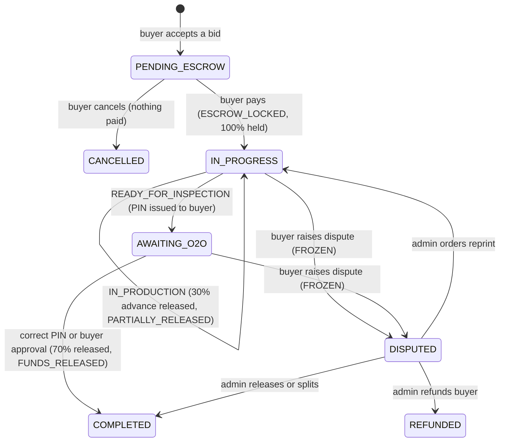

# The CustomT Escrow and Virtual Wallet Mechanism

This chapter explains how CustomT holds a buyer's payment, pays the vendor in two milestones (30% advance and 70% final settlement), and uses a 6-digit Online-to-Offline (O2O) PIN to release the final payment. All of this happens without a banking API. The code references point to `backend/services/orderService.js` unless stated otherwise.

## 1. Design overview

CustomT is a **simulated escrow**. No real money moves between bank accounts. Instead, the platform keeps three kinds of record in MongoDB:

| Record | Where | What it represents |
|---|---|---|
| **Escrow balance** | `Order.escrowHeld` | Money the platform is holding for this order |
| **Escrow ledger** | `Order.escrowLedger[]` | An append-only history of every movement: deposit, advance, final release, refund |
| **Virtual wallets** | `User.walletBalance` | What each vendor has earned (and what each buyer has been refunded) |

Three components work together:

- **Mock payment gateway** (`services/mockPaymentGateway.js`)
  - Plays the role of a card processor such as PayHere or Stripe.
  - Validates the card (Luhn checksum, expiry, CVV) and approves or declines it, using published test card numbers.
  - On approval it returns a receipt with a random transaction reference.
- **Order state machine.** Three status fields move only through allowed transitions, and every money movement is tied to one specific transition. Section 2 shows the states.
- **Ledger and wallets.** Each transition that moves money:
  - appends a ledger entry,
  - lowers `escrowHeld`,
  - raises the recipient's `walletBalance`.

The total is conserved: **deposit = sum of all releases + refunds + what is still held**.

Every operation on an order runs inside a **per-order lock** (`withOrderLock`), so two requests for the same order are processed one after the other. The `Order` schema also uses **optimistic concurrency** (`optimisticConcurrency: true`): each save checks the document's version number, so a stale request can't overwrite a newer state.

## 2. Database state changes in the `Order` model

An order has three independent status fields (`backend/config/constants.js`):

| Field | Values | Meaning |
|---|---|---|
| `orderStatus` | `PENDING_ESCROW`, `IN_PROGRESS`, `AWAITING_O2O`, `DISPUTED`, `COMPLETED`, `REFUNDED`, `CANCELLED` | Where the order is in its life cycle |
| `escrowStatus` | `AWAITING_PAYMENT`, `ESCROW_LOCKED`, `PARTIALLY_RELEASED`, `FROZEN`, `FUNDS_RELEASED`, `REFUNDED`, `SPLIT_SETTLED` | What is happening to the money |
| `productionStatus` | `NOT_STARTED`, `MATERIAL_SOURCED`, `IN_PRODUCTION`, `READY_FOR_INSPECTION`, `DELIVERED` | What the vendor reports about production |



The table below follows one order of **LKR 150,000** from start to finish.

| Step | Trigger (API) | `orderStatus` | `escrowStatus` | `productionStatus` | `escrowHeld` | Ledger entry | Vendor wallet |
|---|---|---|---|---|---|---|---|
| 1. Order created | Buyer accepts a bid: `POST /api/rfqs/:id/bids/:bidId/accept` → `acceptBid()` | `PENDING_ESCROW` | `AWAITING_PAYMENT` | `NOT_STARTED` | 0 | none | 0 |
| 2. Escrow funded | Buyer pays: `POST /api/orders/:id/pay` → `fundEscrow()` | `IN_PROGRESS` | `ESCROW_LOCKED` | `NOT_STARTED` | 150,000 | `ESCROW_DEPOSIT` 150,000 (transaction ref) | 0 |
| 3. Materials sourced | Vendor: `PATCH /api/orders/:id/production {status:"MATERIAL_SOURCED"}` | `IN_PROGRESS` | `ESCROW_LOCKED` | `MATERIAL_SOURCED` | 150,000 | none | 0 |
| 4. **Milestone 1** | Vendor: `{status:"IN_PRODUCTION"}` → `advanceProduction()` | `IN_PROGRESS` | `PARTIALLY_RELEASED` | `IN_PRODUCTION` | 105,000 | `ADVANCE_RELEASE` 45,000 to vendor | 45,000 |
| 5. Ready for inspection | Vendor: `{status:"READY_FOR_INSPECTION"}` | `AWAITING_O2O` | `PARTIALLY_RELEASED` | `READY_FOR_INSPECTION` | 105,000 | none (PIN generated) | 45,000 |
| 6. **Milestone 2** | Vendor enters PIN: `POST /api/orders/:id/o2o/verify` → `verifyO2OPin()` → `completeOrder()` | `COMPLETED` | `FUNDS_RELEASED` | `DELIVERED` | 0 | `FINAL_RELEASE` 105,000 to vendor | 150,000 |

### Step 1: accepting a bid (`acceptBid`)

The order is created from the winning bid. Its key fields are copied from the database, never taken from the request:

```js
const advanceAmount = roundMoney(bid.price * ESCROW.ADVANCE_RATIO);   // 30%
const finalAmount = roundMoney(bid.price - advanceAmount);            // the remainder (70%)

const order = await Order.create({
  agreedPrice: bid.price, advanceAmount, finalAmount, ...           // orderStatus = PENDING_ESCROW (schema default)
});                                                                  // escrowStatus = AWAITING_PAYMENT (schema default)
```

### Step 2: funding escrow (`fundEscrow`)

```js
if (order.orderStatus !== ORDER_STATUS.PENDING_ESCROW || order.escrowStatus !== ESCROW_STATUS.AWAITING_PAYMENT) {
  throw ApiError.conflict('Escrow for this order has already been funded or the order is no longer active');
}
const receipt = await paymentGateway.charge({ amount: order.agreedPrice, card, reference: order.orderCode });

order.escrowHeld = order.agreedPrice;
order.escrowStatus = ESCROW_STATUS.ESCROW_LOCKED;
order.orderStatus = ORDER_STATUS.IN_PROGRESS;
order.escrowLedger.push({ type: 'ESCROW_DEPOSIT', amount: order.agreedPrice, reference: receipt.transactionRef });
await order.save();
```

Three points matter here:
- The **amount charged is `order.agreedPrice`** from the database. The buyer's request contains only card details, so the buyer can't change the amount.
- The **state check** means an order can be funded only once. A second attempt returns HTTP 409.
- If the card is declined, the gateway throws before anything is saved, so the order stays in `PENDING_ESCROW`.

## 3. The 30% advance and 70% final settlement

### How the amounts are calculated

The ratios are constants in `backend/config/constants.js`:

```js
const ESCROW = Object.freeze({ ADVANCE_RATIO: 0.3, FINAL_RATIO: 0.7, O2O_PIN_LENGTH: 6, O2O_MAX_ATTEMPTS: 5 });
```

Both amounts are calculated **once, when the order is created**, and stored on the order (`advanceAmount`, `finalAmount`). Storing them means the split agreed at award time can't change later, even if the constants are edited.

- `roundMoney()` rounds to 2 decimal places, avoiding floating-point drift such as 0.1 + 0.2 ≠ 0.3.
- The final amount is calculated as **price minus advance** rather than price × 0.7, so the two parts always add up to exactly the agreed price. No cent is lost to rounding.

Example: for a price of LKR 100,000.01, the advance is 30,000.00 and the final amount is 70,000.01, which adds up to 100,000.01.

### Milestone 1: the 30% booking advance

The advance pays for materials and labour, so the vendor doesn't have to finance the order alone. It is triggered by one specific production transition: the vendor moving the order from `MATERIAL_SOURCED` to `IN_PRODUCTION`.

```js
// advanceProduction(): the production flow is strictly linear
const expected = PRODUCTION_FLOW[order.productionStatus];         // NOT_STARTED → MATERIAL_SOURCED → IN_PRODUCTION → READY_FOR_INSPECTION
if (!expected || nextStatus !== expected) throw ApiError.badRequest(`The next production step must be ${expected}`);

if (nextStatus === PRODUCTION_STATUS.IN_PRODUCTION && !order.advanceReleased) {
  creditVendor = order.advanceAmount;
  order.advanceReleased = true;
  order.advanceReleasedAt = new Date();
  order.escrowHeld = roundMoney(order.escrowHeld - order.advanceAmount);
  order.escrowStatus = ESCROW_STATUS.PARTIALLY_RELEASED;
  order.escrowLedger.push({ type: 'ADVANCE_RELEASE', amount: order.advanceAmount, toUserId: order.vendorId, note: '30% booking advance (Milestone 1)' });
}

await order.save();                                                                       // 1. record the state change
if (creditVendor > 0) await User.updateOne({ _id: order.vendorId }, { $inc: { walletBalance: creditVendor } }); // 2. credit the wallet
```

The guards that make this safe:
- **Only the assigned vendor** can move production forward (`idEquals(order.vendorId, vendor._id)`).
- **Escrow must be funded first.** `orderStatus` must be `IN_PROGRESS`, which is only reached by paying.
- **Steps can't be skipped or repeated.** `PRODUCTION_FLOW` allows exactly one next step, and the `advanceReleased` flag makes the payout happen once.
- **Production is paused during a dispute.** A `FROZEN` escrow rejects all production updates.
- **Order of writes.** The order is saved before the wallet is credited. If the server stopped between the two writes, the ledger would show the advance as released, and the wallet could be reconciled from it. The reverse order could pay the vendor twice.
- **Atomic increment.** `$inc` is a single MongoDB operation, so two payouts arriving at once for the same vendor (from different orders) never overwrite each other.

### Milestone 2: the 70% final settlement

The final settlement is released by `completeOrder()`, which can only be reached in two ways:

1. **The vendor enters the correct O2O PIN** (`verifyO2OPin`, section 4). This is the normal path.
2. **The buyer approves the inspection directly** (`buyerApproveInspection`), for example after a successful hand-over when the buyer doesn't want to read out the PIN.

An administrator can also settle a disputed order (`resolveDispute`, section 5).

```js
async function completeOrder(order, method, actorId) {
  const amount = order.escrowHeld;                       // everything still held, normally the 70%
  order.escrowLedger.push({ type: 'FINAL_RELEASE', amount, toUserId: order.vendorId, note: `70% final settlement via ${method}` });
  order.escrowHeld = 0;
  order.finalReleased = true;
  order.escrowStatus = ESCROW_STATUS.FUNDS_RELEASED;
  order.orderStatus = ORDER_STATUS.COMPLETED;
  order.productionStatus = PRODUCTION_STATUS.DELIVERED;
  order.o2oVerifiedAt = new Date();
  order.o2oMethod = method;                             // 'PIN' or 'BUYER_APPROVAL'
  order.o2oPin = undefined;                             // the PIN can never be used again
  await order.save();                                   // version-checked: a second concurrent completion fails here
  await User.updateOne({ _id: order.vendorId }, { $inc: { walletBalance: amount } });
}
```

The amount released is `escrowHeld`, the actual remaining balance, not a recalculated 70%. Whatever has not yet been paid out is exactly what is released, so the books always balance.

### Why no banking API is needed

A banking API moves money between accounts. CustomT models those accounts as numbers in the database and records each movement in the ledger. This is the same double-entry idea a real escrow provider uses internally:

| Real-world step | CustomT equivalent |
|---|---|
| Card charge captured by the acquirer | `mockPaymentGateway.charge()` returns a transaction reference |
| Funds held in a trust or escrow account | `Order.escrowHeld` plus an `ESCROW_DEPOSIT` ledger entry |
| Payout to the merchant's account | `$inc` on `User.walletBalance` plus an `ADVANCE_RELEASE` or `FINAL_RELEASE` entry |
| Refund to the cardholder | `$inc` on the buyer's `walletBalance` plus a `REFUND` entry |
| Bank statement | `GET /api/vendor/wallet` (balance, money pending in escrow, transaction list built from the ledgers) |

To use real money, only the edges would change. `mockPaymentGateway.charge()` would call a real gateway, confirmed by the gateway's signed webhook. The wallet credit would become a payout request to the vendor's bank. The state machine, milestones and O2O release stay the same.

## 4. The 6-digit O2O PIN as the release key

The O2O PIN connects the online payment to the offline event it pays for: the buyer physically receiving and inspecting the garments. The 70% final payment is released only when the vendor presents a secret that only the buyer can give, and the buyer gives it only once satisfied with the goods.

Strictly speaking, the PIN is a **one-time authorisation code** (a shared secret), not a cryptographic key in the sense of encryption. It is generated, delivered, stored and checked with cryptographic primitives, described below.

### 4.1 Generation

When the vendor marks the order `READY_FOR_INSPECTION`:

```js
pin = generateNumericPin(ESCROW.O2O_PIN_LENGTH);   // utils/helpers.js
order.o2oPin = sealPin(pin);                        // utils/pinVault.js: encrypted at rest
order.o2oPinGeneratedAt = new Date();
order.o2oAttempts = 0;
order.orderStatus = ORDER_STATUS.AWAITING_O2O;
```

```js
function generateNumericPin(length = 6) {
  const max = 10 ** length;
  return String(crypto.randomInt(0, max)).padStart(length, '0');
}
```

`crypto.randomInt` uses the operating system's cryptographically secure random number generator, so all 1,000,000 PINs from 000000 to 999999 are equally likely and can't be predicted. `Math.random()`, by contrast, is predictable and is never used for PINs.

### 4.2 Delivery (buyer only)

- The PIN is pushed only to the buyer's private Socket.IO room (`o2o:ready`), together with a QR code containing the order code and PIN.
- The buyer can view it again with `GET /api/orders/:id/o2o`. That endpoint is restricted to the buyer of that order.
- The vendor never receives it:
  - the field is `select: false` in the schema;
  - `orderView()` deletes it from every response;
  - the end-to-end test checks that the vendor's copy of the order has no `o2oPin`.

### 4.3 Storage (encrypted at rest)

- The buyer must be able to view the PIN again, so it can't be stored as a one-way hash.
- It is encrypted with AES-256-GCM (`utils/pinVault.js`):
  - the key is derived from the server secret with HKDF-SHA256;
  - each PIN gets a fresh random 12-byte IV;
  - GCM adds an authentication tag, so a modified ciphertext is rejected rather than decrypted to a wrong value.
- Someone with read access to the database or a backup therefore can't learn the PIN.

### 4.4 Verification (the release)

The buyer gives the vendor the PIN at hand-over (spoken, or by scanning the QR code), and the vendor submits it:

```js
async function verifyO2OPin(vendor, orderId, pin) {
  return withOrderLock(orderId, async () => {
    const order = await loadOrderForUser(orderId, vendor, { withPin: true });
    if (!idEquals(order.vendorId, vendor._id)) throw ApiError.forbidden('Only the assigned vendor can submit the O2O PIN');
    assertAwaitingO2O(order);                                  // must be AWAITING_O2O / READY_FOR_INSPECTION, not FROZEN

    if (order.o2oAttempts >= ESCROW.O2O_MAX_ATTEMPTS) throw ApiError.tooMany('Too many incorrect PIN attempts...');
    const cleanPin = String(pin || '').trim();
    if (!/^\d{6}$/.test(cleanPin)) throw ApiError.badRequest('The O2O PIN must be exactly 6 digits');

    const expectedPin = openPin(order.o2oPin);
    if (!expectedPin || !safeEqual(cleanPin, expectedPin)) {
      order.o2oAttempts += 1;                                  // count the failure
      await order.save();
      realtime.emitToUser(order.buyerId, 'o2o:failed-attempt', { attemptsRemaining: ... });   // alert the buyer
      throw ApiError.badRequest(`Incorrect PIN. ${remaining} attempt(s) remaining.`);
    }
    return completeOrder(order, 'PIN', vendor._id);            // Milestone 2: release the 70%
  });
}
```

Each check closes a specific attack:

| Protection | Code | Attack it stops |
|---|---|---|
| Only the assigned vendor may submit | `idEquals(order.vendorId, vendor._id)` | Another vendor, or the buyer, completing the order |
| Only in the right state | `assertAwaitingO2O()` | Releasing funds before production is finished, during a dispute, or a second time |
| Attempt limit (5) | `o2oAttempts >= O2O_MAX_ATTEMPTS` | Guessing. The chance of guessing a 6-digit PIN in 5 tries is 5 in 1,000,000 (0.0005%) |
| Buyer alert on every failure | `o2o:failed-attempt` socket event | Silent guessing; the buyer can raise a dispute at once |
| Constant-time comparison | `safeEqual()` uses `crypto.timingSafeEqual` | Timing attacks that learn the PIN digit by digit from response times |
| Format check | `/^\d{6}$/` | Malformed or oversized input |
| One-time use | `completeOrder()` deletes `o2oPin` | Replaying the PIN on the same order |
| Per-order lock and version check | `withOrderLock` + `optimisticConcurrency` | Two simultaneous correct submissions releasing the money twice |

**Regeneration.** If the PIN is locked after 5 wrong attempts, or the buyer thinks it has been seen, the buyer calls `POST /api/orders/:id/o2o/regenerate`. A new random PIN replaces the old one (which stops working immediately) and the attempt counter resets. Only the buyer can do this, so a vendor can't reset their own attempt limit.

### 4.5 Why this is a sound trust mechanism

Before inspection, the vendor already holds the 30% advance, which covers their costs, and the buyer's remaining 70% is safe in escrow. Neither side can take the other's share alone:

- **The vendor can't** get the 70% without the buyer's PIN. The buyer only hands it over after inspecting the goods.
- **The buyer can't** take back the money unilaterally after accepting the goods. Once the PIN is used, the order is `COMPLETED` and a dispute can no longer be raised.
- **If they disagree**, the buyer raises a dispute instead of giving the PIN (next section).

## 5. Disputes: freezing and settling escrow

A buyer can raise a dispute while money is held: `escrowStatus` must be `ESCROW_LOCKED` or `PARTIALLY_RELEASED`, and `orderStatus` must be `IN_PROGRESS` or `AWAITING_O2O`.

- The escrow becomes `FROZEN`. Production updates and PIN verification are then refused.
- The previous statuses are saved, so the order can resume afterwards.
- An administrator settles the dispute with `resolveDispute()`:

| Resolution | Money movement | Final state |
|---|---|---|
| `RELEASE_TO_VENDOR` | All of `escrowHeld` to the vendor's wallet (`DISPUTE_RELEASE`) | `COMPLETED` / `FUNDS_RELEASED` |
| `REFUND_BUYER` | All of `escrowHeld` to the buyer's wallet (`REFUND`) | `REFUNDED` / `REFUNDED` |
| `SPLIT` (1–99% to the vendor) | Vendor share = `roundMoney(held × pct / 100)`; buyer share = the rest | `COMPLETED` / `SPLIT_SETTLED` |
| `RESUME_PRODUCTION` | None. Escrow returns to its previous status. If the goods were already ready, production goes back to `IN_PRODUCTION` and the old PIN is cancelled (reprint) | Previous state |

In every case only the money still held (`escrowHeld`) is distributed. The 30% advance already paid stays with the vendor, because it paid for materials and work already done.

## 6. Integrity guarantees (summary)

1. **Conservation.** For every order, `ESCROW_DEPOSIT = ADVANCE_RELEASE + FINAL_RELEASE + DISPUTE_RELEASE + REFUND + escrowHeld`. Every subtraction from `escrowHeld` is matched by a ledger entry and a wallet credit.
2. **Server-side amounts.** Prices, splits and payouts are calculated on the server from stored values. No client request contains an amount.
3. **Single execution.**
   - Each payout is tied to a one-way state transition, guarded by a flag (`advanceReleased`, `finalReleased`) or by `escrowHeld` reaching 0.
   - Requests for the same order are serialised by a per-order lock.
   - The order's version number is checked on every save.
4. **Fail-safe ordering.** The order (with its ledger) is saved before any wallet is credited, so a failure can lead to under-payment that is visible and can be fixed from the ledger, never to a double payment.
5. **Auditability.** The ledger is append-only, and every production step, PIN regeneration and dispute is also written to `productionTimeline` with the actor and time.
6. **Separation of duties.**
   - Only the buyer can pay, view or regenerate the PIN, approve the inspection, or raise a dispute.
   - Only the assigned vendor can update production and submit the PIN.
   - Only an administrator can settle a dispute.
