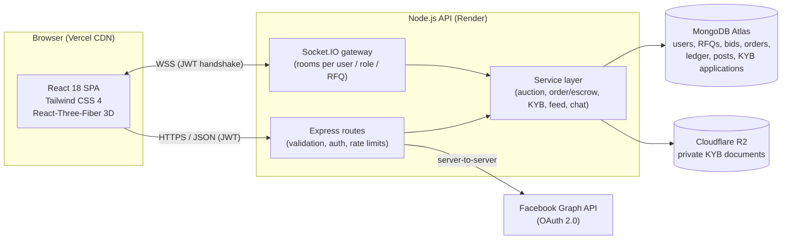
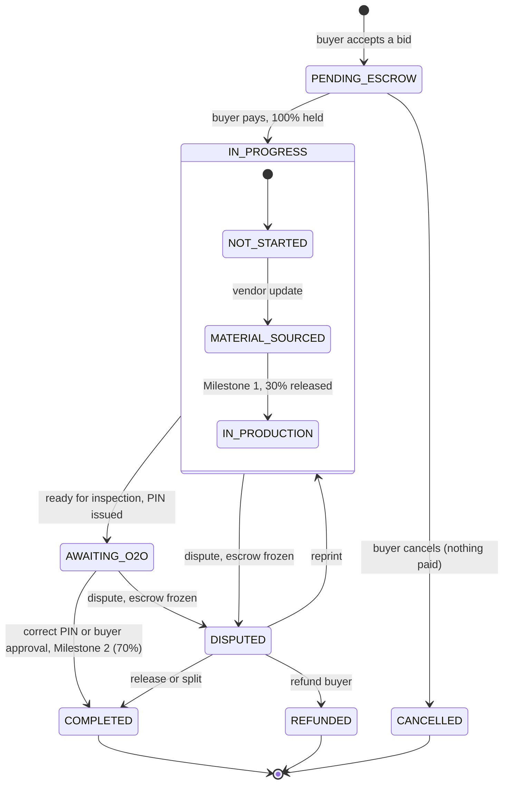
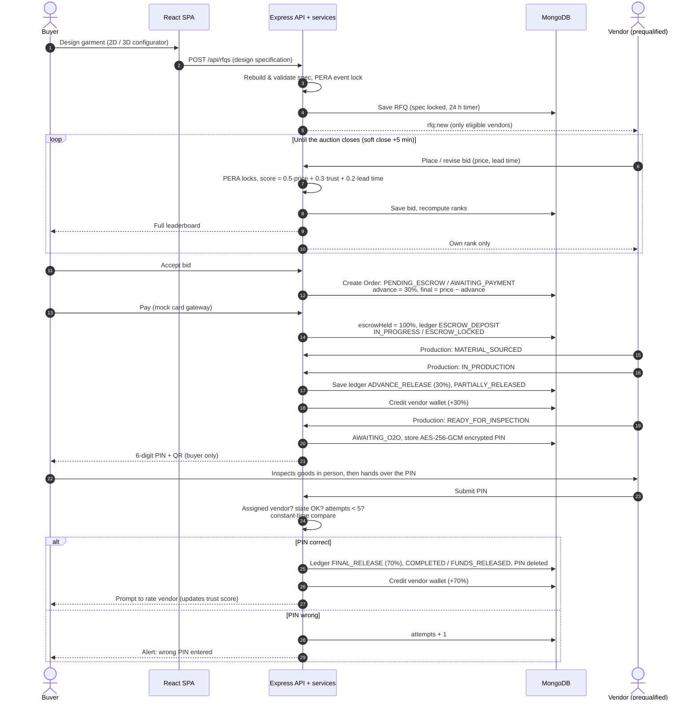

# CustomT: System Architecture and Operational Report

**A reverse-auction and escrow marketplace for custom apparel procurement**

*Technical report for the final-year software engineering thesis. All figures, thresholds and state names in this document are taken from the CustomT source code (`backend/config/constants.js`, `backend/services/*`, `backend/models/*`) at the time of writing. High-resolution renderings of the three diagrams are in `docs/diagrams/` (architecture overview, order state machine, escrow sequence).*

---

## Abstract

CustomT is a web platform through which buyers (event organisers, companies, clubs) procure custom-printed garments from small and medium-sized Sri Lankan apparel printers. Instead of fixed prices, a buyer designs the garment in an interactive 2D/3D configurator, and prequalified printers compete in a time-boxed **multi-attribute reverse auction**. The winning order is paid into a **virtual escrow**. It is released in two milestones: a 30% advance when production starts, and the remaining 70% only when the buyer has physically inspected the goods and handed the vendor a one-time **Online-to-Offline (O2O) PIN**.

This report describes:
- the architecture and technology choices;
- the auction and ranking logic;
- in depth, the escrow ledger, its state machine and the O2O PIN mechanism;
- the security controls protecting money, identity documents and the platform's business model.

---

## 1. System architecture and technology stack

### 1.1 Overview

CustomT follows a **three-tier, client–server architecture** with a single-page application (SPA) front end, a stateless REST API with a real-time channel, and a managed document database.



| Tier | Technology | Hosting |
|---|---|---|
| Presentation | React 18, Vite 6, Tailwind CSS 4, React Router 7, Axios, Socket.IO client; three.js 0.172 with `@react-three/fiber` 8 and `@react-three/drei` 9 for 3D | Vercel (static CDN with security headers) |
| Application | Node.js 22, Express 4, Socket.IO 4, Mongoose 8, JSON Web Tokens, bcrypt, Helmet, Multer, sharp, AWS SDK v3 (S3 API), Nodemailer | Render (web service) |
| Data | MongoDB (Atlas); Cloudflare R2 (S3-compatible object storage) for identity documents | Managed cloud services |
| Quality | `node:test` unit tests and an end-to-end suite against a real MongoDB 7 instance in GitHub Actions | GitHub |

### 1.2 Front end

The SPA is organised by role (buyer, vendor, admin) with shared contexts:
- **`AuthContext`:** the session.
- **`SocketContext`:** an authenticated real-time connection, plus a notification centre.
- **`CatalogContext`:** every configurable option, fetched once from `/api/meta/catalog`, so the client never hard-codes business rules.

The **design configurator** has two renderers:
- **2D layered SVG** (`TShirtPreview`): front, back and both sleeves, with draggable text and image layers.
- **3D viewer** (`Shirt3DViewer`): built with React-Three-Fiber. The design is painted onto a canvas texture atlas and mapped onto glTF garment models generated by the project from the same outlines as the 2D views (`scripts/build-garment-models.mjs`). A point placed in 2D therefore lands on the same spot in 3D. Users can rotate the garment 360°, zoom and pan it (OrbitControls).

The three.js bundle (about 255 KB gzipped) is **lazy-loaded** only when the user opens the 3D view, so the rest of the application stays light.

### 1.3 Back end: layered architecture with a service layer

The API separates concerns into three layers:

1. **Routes** (`backend/routes/*`): HTTP concerns only. Authentication (`protect`), role authorisation (`authorize`), PERA qualification checks, rate limiting, and translating requests into service calls.
2. **Services** (`backend/services/*`): all business logic. Examples: `auctionService` (RFQs, bidding, ranking, soft close), `orderService` (escrow, milestones, O2O, disputes, trust), `kybService` (vendor onboarding), `feedService` (posts and storefronts), `chatService`.
3. **Models** (`backend/models/*`): Mongoose schemas with validation and **invariants enforced at the data layer**. For example, the RFQ specification lock and the post content filter run as schema hooks, so no code path can bypass them.

Because both the REST API and the Socket.IO gateway call the same service functions, a rule such as "a vendor must be prequalified to bid" is implemented **once** and enforced for both channels.

Concurrency is handled at two levels:
- a per-key in-process mutex (`KeyedMutex`) serialises operations on the same RFQ or order;
- **optimistic concurrency** (document version checks) on orders and KYB applications makes state transitions safe even across several server instances.

### 1.4 Data and storage

- **MongoDB** stores users, RFQs, bids, orders (including the escrow ledger), chat messages, feed posts, KYB applications, access logs and authentication tickets. A document database suits the variable, nested data well: design layers, size breakdowns, ledger entries and production timelines are stored inside their parent document and read in one query.
- **Keyset (cursor) pagination** is used for the infinite-scroll Global Feed and storefront tabs. Pages are selected by `(createdAt, _id) < cursor` on a compound index rather than by `skip`. The result:
  - every page costs the same regardless of depth;
  - new posts arriving during scrolling never cause duplicates or gaps.

  Administrative lists, which are small and need page numbers, use conventional offset pagination.
- **Cloudflare R2** stores KYB evidence (business registration, national identity cards, utility bills, invoices) in a private bucket with no public URL. Only an object key is stored in MongoDB.
- Several collections clean themselves up with **TTL indexes**: one-time authentication tickets expire automatically.

### 1.5 Rationale for the stack

| Requirement | Choice and justification |
|---|---|
| Real-time bidding with many simultaneous viewers | Node.js's event loop handles many idle WebSocket connections cheaply; Socket.IO adds rooms, reconnection and acknowledgements. |
| One language across tiers | JavaScript on client and server shares the validation constants and lets one developer maintain the whole system. |
| Evolving, nested domain data | MongoDB's document model maps directly onto RFQ specifications, ledgers and timelines without join tables; Mongoose adds schemas and validation. |
| Rich but fast UI | React's component model and Tailwind's utility classes give a consistent design system; Vite gives fast builds; heavy 3D code is loaded on demand. |
| Cost | Every service has a free tier suitable for a pilot (Vercel, Render, MongoDB Atlas M0, Cloudflare R2 with no egress fees). |
| Security of sensitive files | R2/S3 provides private buckets, encryption at rest and short-lived presigned URLs. Storing NIC images on the application server's disk would have been both insecure and lost on every redeploy. |

---

## 2. Business logic: the reverse-auction flow

### 2.1 Creating a Request for Quotation (RFQ) in the configurator

1. The buyer chooses garment type (crew neck, polo, hoodie), fabric, GSM weight, base colour and print method.
2. In the artwork editor the buyer adds **text layers** (font, size, colour) and **image layers** to four printable sides: front, back, left sleeve and right sleeve. Each layer is positioned by dragging on the 2D view and can be previewed on the 3D model.
3. The buyer fills a size matrix (S–XXL; minimum order quantity 20).
4. **Delivery time is estimated live:**
   - base days for the print method (screen 7, DTF 5, embroidery 10, sublimation 6);
   - plus extra days for the garment (polo +1, hoodie +2);
   - plus one day per additional 100 pieces;
   - plus one day per extra printed side.
5. **The PERA event-level lock** is checked live: the server reports how many *prequalified* vendors could fulfil this exact print method and quantity. An RFQ cannot be launched if that number is zero.
6. On launch, the server rebuilds and validates the specification itself (`buildDesignSpecs`) rather than trusting the client.
   - The specification is then **locked** (the CPAPO protection): schema hooks reject any later change to the design, so vendors bid on an immutable specification.
   - A 24-hour auction starts, and only eligible vendors are notified in real time.

A buyer can alternatively send a **Direct Quote** request to a single vendor from that vendor's storefront. It follows the same flow with one eligible bidder, and still ends in escrow.

### 2.2 Vendor eligibility: the PERA locks

| Lock | Condition | Enforced in |
|---|---|---|
| Qualification level | Vendor account is active, verified by an administrator (KYB), and its business licence has not expired | Every bid, auction-room join, and the vendor RFQ feed |
| Participant level | Vendor offers the RFQ's print method and its capacity is at least the order quantity | Every bid and auction-room join |
| Event level | At least one vendor passes both locks above | RFQ creation |

### 2.3 Bidding, ranking and the role of the trust score

Vendors submit a total price, a lead time and optional notes. They may revise a bid any number of times while the auction is open, but by default never raise the price. Each submission recomputes the ranking with a **weighted multi-attribute score**:

$$
\text{score} = 0.5\cdot\frac{p_{\min}}{p} \;+\; 0.3\cdot\frac{t}{t_{\max}} \;+\; 0.2\cdot\frac{d_{\min}}{d}
$$

where:
- $p$ is the bid price;
- $t$ is the vendor's trust score at the moment of bidding;
- $d$ is the lead time in days;
- the minima and maximum are taken over all bids on the RFQ.

Each component is normalised to (0, 1], so the best possible score is 1.0. Ties are broken deterministically: lower price, then shorter lead time, then earlier submission.

**Trust score.** Every vendor starts at 3.5 (on a 1–5 scale). After each completed order, the buyer's 1–5 rating updates it with an exponentially weighted moving average:

$$
t_{\text{new}} = 0.7\,t_{\text{old}} + 0.3\,r
$$

Recent performance therefore matters, but a single rating cannot swing a reputation. Trust carries 30% of the score, so a reliable vendor can win against a slightly cheaper but poorly rated competitor. This is the intended "best value, not lowest price" behaviour.

**Integrity of the ranking:**
- Vendors send only price, lead time and notes. Score, rank and the trust snapshot are computed on the server.
- Lead times below half of the platform's realistic production estimate are rejected, so an impossible "1-day" quote cannot buy the 20% lead-time component.
- Only one rating per buyer–vendor pair in 30 days affects trust, and a buyer cannot award an order to a vendor account registered with the same phone number. Together these prevent self-rating to inflate trust.

**Rank-based partial visibility.**
- The buyer (and administrators) see the full leaderboard with score breakdowns.
- Each vendor sees only their own rank ("Your rank: #2 of 5"), never competitors' prices or identities.
- The shared auction room broadcasts only the bid count and the timer.

**Soft close.** A bid placed in the final 2 minutes extends the auction by 5 minutes. This removes the advantage of last-second sniping.

**Price-signal diagnostic.** When there are at least 3 bids and their coefficient of variation exceeds 0.35, the buyer is warned that vendors may have interpreted the specification differently.

When the auction ends, the buyer reviews the ranked bids and **accepts one**. This creates the `Order`, which enters the escrow process described next.

---

## 3. Deep dive: the escrow and virtual ledger system

### 3.1 Purpose

Custom apparel is made to order. The buyer fears paying for goods that never arrive or are defective; the vendor fears buying materials for an order the buyer then abandons. CustomT resolves this with a **conditional, two-milestone escrow**: the platform holds the buyer's money and releases it in step with verifiable progress.

### 3.2 A virtual ledger instead of a banking API

CustomT simulates escrow without moving real money between bank accounts. It keeps three kinds of financial record in MongoDB:

| Record | Location | Meaning |
|---|---|---|
| Escrow balance | `Order.escrowHeld` | Money currently held by the platform for this order |
| Escrow ledger | `Order.escrowLedger[]` | Append-only history of every movement: `ESCROW_DEPOSIT`, `ADVANCE_RELEASE`, `FINAL_RELEASE`, `DISPUTE_RELEASE`, `REFUND` |
| Virtual wallets | `User.walletBalance` | Funds credited to a vendor (payouts) or a buyer (refunds) |

The buyer's card payment is processed by a **mock payment gateway** (`services/mockPaymentGateway.js`). It validates the card (Luhn checksum, expiry, CVV), approves or declines it according to published test card numbers, and returns a transaction reference recorded with the deposit.

The design is equivalent to the double-entry bookkeeping a real escrow provider performs internally. Moving to real money would replace only the edges: the gateway call, confirmed by the provider's signed webhook, and the payout of wallet balances. The state machine and milestone logic stay as they are.

**Conservation invariant.** For every order:

$$
\text{ESCROW\_DEPOSIT} = \text{ADVANCE\_RELEASE} + \text{FINAL\_RELEASE} + \text{DISPUTE\_RELEASE} + \text{REFUND} + \text{escrowHeld}
$$

Every reduction of `escrowHeld` is matched by a ledger entry and a wallet credit.

### 3.3 The order state machine

An order carries three status fields that evolve together:
- **`orderStatus`:** where the order is in its life cycle.
- **`escrowStatus`:** what is happening to the money.
- **`productionStatus`:** progress reported by the vendor.



*Escrow status along the main path:* `AWAITING_PAYMENT` (pending escrow), then `ESCROW_LOCKED` (paid), then `PARTIALLY_RELEASED` (after Milestone 1), then `FUNDS_RELEASED` (completed). A dispute sets `FROZEN`. Settling a dispute ends in `FUNDS_RELEASED`, `SPLIT_SETTLED` or `REFUNDED`, or a reprint returns to the previous escrow status.

The main path, for an order of **LKR 150,000**:

| Step | Trigger | `orderStatus` | `escrowStatus` | `productionStatus` | `escrowHeld` | Ledger entry | Vendor wallet |
|---|---|---|---|---|---|---|---|
| 1 | Buyer accepts a bid | `PENDING_ESCROW` | `AWAITING_PAYMENT` | `NOT_STARTED` | 0 | none | 0 |
| 2 | Buyer pays (mock card) | `IN_PROGRESS` | `ESCROW_LOCKED` | `NOT_STARTED` | 150,000 | `ESCROW_DEPOSIT` 150,000 | 0 |
| 3 | Vendor: materials sourced | `IN_PROGRESS` | `ESCROW_LOCKED` | `MATERIAL_SOURCED` | 150,000 | none | 0 |
| 4 | **Milestone 1:** vendor starts production | `IN_PROGRESS` | `PARTIALLY_RELEASED` | `IN_PRODUCTION` | 105,000 | `ADVANCE_RELEASE` 45,000 | 45,000 |
| 5 | Vendor: ready for inspection | `AWAITING_O2O` | `PARTIALLY_RELEASED` | `READY_FOR_INSPECTION` | 105,000 | none (PIN issued) | 45,000 |
| 6 | **Milestone 2:** correct O2O PIN | `COMPLETED` | `FUNDS_RELEASED` | `DELIVERED` | 0 | `FINAL_RELEASE` 105,000 | 150,000 |

Every transition is guarded on the server by the **current** state:
- payment is accepted only in `PENDING_ESCROW`/`AWAITING_PAYMENT`;
- production can advance only one step at a time along a fixed sequence (`PRODUCTION_FLOW`), and only by the assigned vendor;
- no production update is accepted while escrow is `FROZEN`.

An order therefore cannot be paid twice, skip a stage, or release money out of order.

### 3.4 The milestones: 30% advance and 70% final settlement

**Calculation.** Both amounts are computed **once**, when the bid is accepted, and stored on the order:

```js
const advanceAmount = roundMoney(bid.price * ESCROW.ADVANCE_RATIO); // 30%
const finalAmount = roundMoney(bid.price - advanceAmount);         // the remainder
```

The final amount is the price *minus* the advance, not 70% computed separately, so the two parts always sum exactly to the agreed price despite rounding to cents. Because they are stored, later configuration changes cannot alter an existing contract.

**Milestone 1 (advance).** When the vendor moves production from `MATERIAL_SOURCED` to `IN_PRODUCTION`, the service:
- records the release (`advanceReleased = true`);
- reduces `escrowHeld` by the advance;
- sets `escrowStatus = PARTIALLY_RELEASED`;
- appends an `ADVANCE_RELEASE` ledger entry;
- then credits the vendor's wallet with an atomic `$inc`.

The advance finances materials and labour, so small printers do not have to fund the order themselves.

**Milestone 2 (final settlement).** The remaining `escrowHeld` (normally 70%) is released by `completeOrder()`, reachable only through:
- the vendor submitting the correct O2O PIN (the normal path); or
- the buyer explicitly approving the inspection.

The amount released is the *actual remaining balance*, so the books always balance.

**Failure safety.** In both milestones the order document (with its ledger entry) is **saved before** the wallet is credited, and every save is version-checked (optimistic concurrency).
- If two requests race, one fails with HTTP 409 before any money moves.
- If the server stopped between the two writes, the result would be a visible, reconcilable under-payment, never a double payment.

### 3.5 The O2O PIN: the final authorisation code

The Online-to-Offline PIN links the online payment to the offline event it pays for: the buyer physically receiving and inspecting the garments. It is a **one-time authorisation code**, a shared secret that only the buyer can hand to the vendor. It is generated, delivered, stored and checked with cryptographic primitives.

**Generation.** When the vendor marks the order `READY_FOR_INSPECTION`:

```js
const pin = String(crypto.randomInt(0, 10 ** 6)).padStart(6, '0'); // CSPRNG, uniform over 000000–999999
order.o2oPin = sealPin(pin);                                        // encrypted before storage
order.o2oAttempts = 0;
order.orderStatus = 'AWAITING_O2O';
```

`crypto.randomInt` draws from the operating system's cryptographically secure random number generator, so all one million PINs are equally likely and unpredictable.

**Delivery (buyer only).**
- The PIN, with a QR code of the order code and PIN, is pushed only to the buyer's private real-time room.
- It is also available through an endpoint restricted to that order's buyer.
- The vendor never receives it: the field is excluded from queries by default, removed from every order response, and an automated test asserts its absence from the vendor's view.

**Storage (encrypted at rest).** The buyer must be able to view the PIN again, so it cannot be hashed. Instead it is encrypted with **AES-256-GCM**:
- the key is derived from the server secret with HKDF-SHA256;
- each PIN gets a fresh random 96-bit IV;
- an authentication tag detects any tampering with the stored value.

A person who obtains a database backup therefore learns nothing usable.

**Verification.** At hand-over the buyer reads the PIN aloud or shows the QR code, and the vendor submits it. The server enforces:

| Check | Threat mitigated |
|---|---|
| Only the vendor assigned to the order may submit | Another vendor, or the buyer, completing the order |
| Order must be `AWAITING_O2O` / `READY_FOR_INSPECTION`, and escrow not `FROZEN` | Release before production is finished, during a dispute, or twice |
| At most **5** wrong attempts, then the PIN locks until the buyer generates a new one | Guessing: the probability of success is at most 5 in 1,000,000 |
| The buyer is notified in real time of every wrong attempt | Silent guessing; the buyer can dispute immediately |
| Constant-time comparison (`crypto.timingSafeEqual`) | Timing attacks that learn the PIN digit by digit |
| PIN deleted on completion | Replay of a used PIN |
| Per-order lock and document version check | Two simultaneous submissions releasing money twice |

**Regeneration.** Only the buyer can issue a new PIN (for example after a lock-out, or if the PIN was overheard). The new PIN invalidates the old one and resets the attempt counter, so a vendor can never reset their own attempt limit.

**Mutual protection.** At the moment of inspection, the vendor already holds the 30% advance, covering costs incurred, and the remaining 70% is safe in escrow.
- **The vendor cannot** obtain the 70% without the PIN, which the buyer gives only after inspecting the goods.
- **The buyer cannot** reclaim the money unilaterally after accepting the goods: once the PIN is used, the order is `COMPLETED` and disputes are no longer possible.
- **If they disagree,** the buyer withholds the PIN and raises a dispute instead (section 3.6).

### 3.6 Disputes

A buyer can raise a dispute only while funds are held (escrow `ESCROW_LOCKED` or `PARTIALLY_RELEASED`). Escrow becomes `FROZEN`, and production updates and PIN verification are refused. The buyer's complaint is passed to the vendor through politeness templates that soften hostile wording. An administrator then resolves the case:

| Resolution | Effect on the money still held |
|---|---|
| `RELEASE_TO_VENDOR` | All of it to the vendor (`DISPUTE_RELEASE`) |
| `REFUND_BUYER` | All of it to the buyer's wallet (`REFUND`) |
| `SPLIT` (1–99% to vendor) | Divided; the buyer's share is the exact remainder |
| `RESUME_PRODUCTION` | None; escrow returns to its previous state. If goods were ready, production returns to `IN_PRODUCTION` and the old PIN is cancelled (reprint) |

The 30% advance already paid stays with the vendor, as payment for work already performed.

---

## 4. End-to-end escrow and order flow



---

## 5. Security measures

### 5.1 Identity and access

- **Authentication.**
  - JSON Web Tokens signed with HS256; the algorithm is pinned, and production refuses to start with a weak secret.
  - Passwords are hashed with bcrypt (cost 12).
  - Every request reloads the user from the database, so suspensions and role changes take effect immediately.
  - Tokens issued before a password change are rejected, and live Socket.IO connections are closed.
- **Password reset** links are single-use (signed with the current password hash) and expire after 15 minutes.
- **Facebook Login** uses the server-side OAuth 2.0 Authorization Code flow:
  - a CSRF `state` bound to an HttpOnly cookie;
  - `appsecret_proof` on Graph API calls;
  - no storage of Facebook tokens;
  - a one-time 60-second code instead of a session token in the URL;
  - no automatic linking to an existing account with the same e-mail address, which prevents account takeover.
- **Authorisation.**
  - Role checks on every route.
  - Ownership checks in every service: buyers see their own RFQs and orders, vendors their own bids, and the parties of an order its chat.
  - Unified **buyer-only registration**: the vendor role is granted only by an administrator's KYB approval, through a single state-machine function.

### 5.2 KYB document protection (Cloudflare R2)

- Evidence (BR copy, NIC, utility bill, invoices) is stored in a **private R2 bucket**: no public URL, no CORS, and an API token scoped to that one bucket. Objects are encrypted at rest.
- Uploads are inspected on the server:
  - the real file type comes from the file's content, not the browser's claim;
  - PDFs containing JavaScript, embedded files or encryption are refused;
  - images are **re-encoded**, which removes EXIF metadata such as GPS location.

  Files never touch the server's disk.
- Only administrators can view documents. Files are streamed through the API with `no-store` and sandbox headers, or opened through a **60-second presigned URL**. Every view is written to an append-only **access log**.
- The **NIC number is never stored**: only a keyed HMAC-SHA256 fingerprint (to detect one person behind several vendor accounts) and the last four characters.
- Rejected or withdrawn applications have their documents deleted after 180 days (data minimisation).

### 5.3 Protecting the business model: the contact-information filter

A marketplace loses its value, and its users lose escrow protection, if buyers and vendors move the transaction off-platform (disintermediation). CustomT masks contact details as `[CONTACT BLOCKED]` **before storage** in every channel the counterparty can read:
- chat messages;
- bid notes;
- RFQ descriptions;
- production notes;
- dispute notes;
- reviews;
- vendor post captions and storefront bios.

Names containing contact details are rejected.

The filter (`utils/contactFilter.js`) detects:
- phone numbers, including spaced and spelled-out digits;
- e-mail addresses, including "name at gmail dot com";
- links;
- messaging-app names, even letter-spaced;
- phrases such as "call me" or "pay me directly".

Before matching, it **normalises** the text, defeating common evasions such as full-width digits, zero-width characters and keycap emoji. Buyers' and vendors' phone numbers and e-mail addresses are also stripped from every response the counterparty receives.

### 5.4 Data-integrity guards

- **Specification lock (CPAPO):** a `pre('save')` hook and query hooks on `updateOne`, `updateMany` and `findOneAndUpdate` reject any change to a locked RFQ design.
- **Post content guard:** feed posts can change only through document saves, which run the contact filter. Query-level updates that touch content are rejected, so the filter cannot be bypassed.
- **Escrow and KYB decisions:** optimistic concurrency, plus a per-key mutex, plus state checks make every money movement and approval happen exactly once.
- **Server-side computation:** prices, escrow amounts, scores and ranks are never accepted from the client.
- **Input safety:** every value used in a database query is cast or checked against an allow-list, which prevents NoSQL operator injection. Search strings are regex-escaped.

### 5.5 Web-application hardening (XSS, CSP and headers)

- **XSS:** React escapes all user content, the code never injects raw HTML, and image URLs are restricted to files uploaded to CustomT by the same user. This was verified in a browser with script-injection payloads, which rendered as plain text.
- **Content-Security-Policy** on the website: `script-src 'self'` (WebAssembly only, no `eval`), `frame-ancestors 'none'`, `object-src 'none'`, and connections allowed only to the CustomT API. The site also sends HSTS, `X-Content-Type-Options: nosniff`, a strict referrer policy and a permissions policy. Helmet secures the API's headers.
- **Uploads:** content-type sniffing, per-user quotas, and SVG files served in a sandbox.
- **Abuse limits:** rate limits on sign-in, password reset, Facebook Login, publishing, uploads and chat, plus a per-connection limit on real-time events.

### 5.6 Verification

The rules above are covered by automated tests that run on every change in GitHub Actions:
- **unit tests:** scoring, contact filtering, design validation, NIC handling, file inspection, the KYB state machine, post validation;
- **an end-to-end suite** against a real MongoDB 7 database, exercising the complete lifecycle: registration, PERA locks, bidding and ranking, escrow funding, both milestones, O2O verification, disputes, chat filtering, password reset, the Global Feed, KYB onboarding and Facebook Login.

---

## 6. Limitations and future work

- **Payments are simulated.** A production deployment would integrate a licensed gateway (for example PayHere or Stripe), confirm payments through signed webhooks, and pay out wallet balances to bank accounts.
- **Multi-document atomicity.** The two-step "save order, then credit wallet" sequence is fail-safe but not atomic. MongoDB transactions on a replica set would make it all-or-nothing.
- **Verification of contact details.** Phone numbers are self-declared. SMS one-time-password verification would strengthen the self-dealing and identity checks.
- **Content in images.** The contact filter reads text only. Contact details drawn inside photos require moderation (a report button, or optical character recognition).
- **Session storage.** The session token lives in browser storage, mitigated by the strict CSP. HttpOnly cookies with CSRF protection would remove that exposure entirely.
